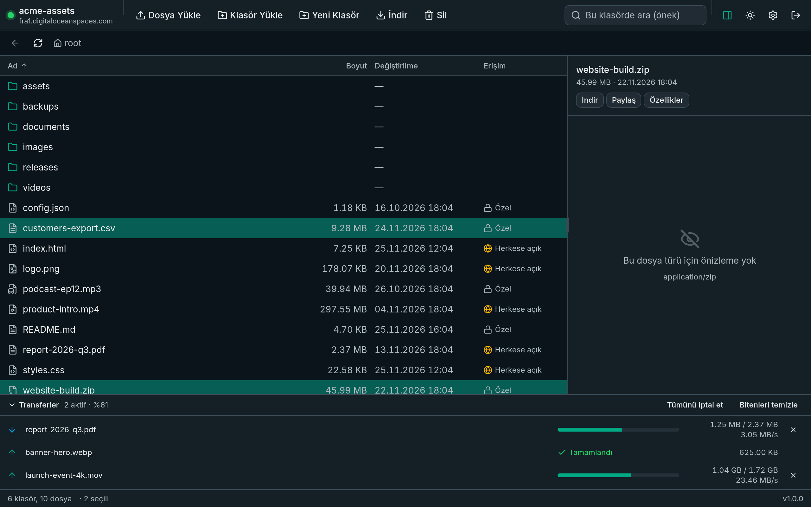

<div align="center">

# S3MANAGER

**Cross-platform desktop file manager for DigitalOcean Spaces and other S3-compatible storage services**

[](LICENSE)
[](https://github.com/bahadirdogru/S3MANAGER/releases)
[](https://tauri.app/)
[](https://www.rust-lang.org/)
[](https://svelte.dev/)
[](https://github.com/bahadirdogru/S3MANAGER/releases)
[](https://s3manager.bahadirdogru.com/)

[Features](#features) · [Installation](#installation) · [Website](https://s3manager.bahadirdogru.com/) · [Roadmap](#roadmap) · [Usage](#usage) · [Development](#development) · [Documentation](#documentation)

</div>

---

> **Doc Map** — Project documentation guide
>
> | File | What to read it for |
> |------|---------------------|
> | [README.md](README.md) | Installation, usage, project overview (English — GitHub/GitLab homepage) |
> | [readmetr.md](readmetr.md) | Kurulum, kullanım, proje tanıtımı (Türkçe) |
> | [docs/](docs/) | Marketing website ([s3manager.bahadirdogru.com](https://s3manager.bahadirdogru.com/)) |
> | [UI.md](UI.md) | Colors, theme tokens, shadcn-svelte component and UX rules |
> | [ARCHITECTURE.md](ARCHITECTURE.md) | Architecture layers, data flow, concurrency (human-readable) |
> | [LLM.md](LLM.md) | Current code structure, file map, development constraints (LLM) |
> | [PROCESS.md](process.md) | Chronological change log (changelog) |
>
> Turkish version: [readmetr.md](readmetr.md)

## About

**S3MANAGER** lets you manage files on DigitalOcean Spaces — or any S3-compatible service such as AWS S3, MinIO or Cloudflare R2 — with a native desktop experience. Upload, download, sharing and folder management come together in a single modern interface.

Since v1.0.0 the app is built with **Tauri 2**: a **Rust** backend (`aws-sdk-s3`, `tokio`) and a **SvelteKit + TypeScript** frontend using **shadcn-svelte** components. The earlier PySide6 (Python) version is available in releases up to v0.0.9.

This project is developed by [Bahadır Doğru](https://bahadirdogru.com) under the name **S3MANAGER** and is released as open source under the **GPL-3.0** license.

## Features

<table>
<tr>
<td width="50%" valign="top">

### 📁 File Explorer
- Breadcrumb navigation, back history
- Paginated lazy loading (infinite scroll)
- Column sorting, Ctrl/Shift multi-select
- Copy / move / rename (F2, Ctrl+C/X)
- Server-side prefix search
- Right-panel preview (images, text)
- Lazy ACL badges for visible rows

### ⬆️ Upload
- File and folder upload
- Drag-and-drop onto the main window
- Private / Public ACL
- Automatic Content-Type, Content-Disposition, Cache-Control
- Multipart (>16 MB) with per-part progress
- Parallel uploads (max 3); cancel aborts the multipart upload

</td>
<td width="50%" valign="top">

### ⬇️ Download & Share
- Single / multi-file and folder download
- Written to `.part`, renamed when complete
- 3- or 7-day presigned URLs, copied to clipboard
- Public URL for public-read objects

### 🎨 Modern UI
- Tauri 2 + SvelteKit + shadcn-svelte
- WhatsApp-inspired dark/light theme
- Transfer panel with speed and progress
- Toast notifications, keyboard shortcuts
- Details: [UI.md](UI.md)

</td>
</tr>
</table>

### Screenshot



More screenshots: [marketing site](https://s3manager.bahadirdogru.com/#ekran-goruntuleri)

## Installation

### Binary (end user)

Download the file for your platform from [Releases](https://github.com/bahadirdogru/S3MANAGER/releases):

| Platform | File |
|----------|------|
| Windows | `S3MANAGER_<version>_x64-setup.exe` (NSIS) or `S3MANAGER_<version>_x64_tr-TR.msi` |
| macOS (Apple Silicon) | `S3MANAGER_<version>_aarch64.dmg` |
| macOS (Intel) | `S3MANAGER_<version>_x64.dmg` |
| Linux x86_64 | `.AppImage`, `.deb` or `.rpm` |

Minimum macOS is **10.15 Catalina** (Tauri/WKWebView). Linux needs WebKitGTK 4.1 (preinstalled on current GNOME/KDE distributions).

> **Note:** Binaries are not code-signed; Windows SmartScreen / macOS Gatekeeper may show warnings.

### From source

Requirements: [Rust](https://rustup.rs/) (stable), Node.js 22+, pnpm, and the [Tauri system prerequisites](https://tauri.app/start/prerequisites/) (on Fedora: `webkit2gtk4.1-devel gtk3-devel libsoup3-devel openssl-devel`).

```bash
git clone https://github.com/bahadirdogru/S3MANAGER.git
cd S3MANAGER
pnpm install
pnpm tauri dev
```

On first run enter your access key, secret, region/endpoint and bucket. Credentials are saved to `~/.s3manager/config.ini` — the same file the Python version used, so existing settings keep working.

## Usage

### Connection

1. Choose **DigitalOcean Spaces** (pick a region) or **Other S3-compatible** (endpoint, region, optional path-style addressing for MinIO and similar)
2. Enter bucket, access key and secret → **Connect** (connection is validated with `HeadBucket`)
3. With saved credentials the app connects automatically on launch

### File explorer

- Double-click (or Enter) a folder to open it; navigate with breadcrumbs, **Back** (Backspace / Alt+←), **Refresh** (F5)
- Click column headers to sort; Ctrl/Shift-click to multi-select; right-click for the context menu
- Search box filters the current folder by name prefix on the server

### Upload

1. **Upload File** / **Upload Folder**, or drag files onto the window
2. Review the list (files that will be overwritten are marked), choose Private/Public → **Start upload**
3. Progress, speed and status appear in the bottom transfer panel; each transfer can be cancelled

Content-Type and Content-Disposition are set from the file extension (e.g. `.html` opens in the browser, `.zip` downloads). Rules are edited in **Settings → Metadata** (`[upload_metadata]` in `config.ini`).

### Download

Select files/folders → **Download** → choose a destination folder. Folders are downloaded recursively. Finished downloads have a **Show in folder** button.

### Share

Right-click a file → **Share (3 days)** / **Share (7 days)**. The presigned link is copied to the clipboard automatically.

### Object properties

Right-click → **Properties** (or Enter / double-click on a file): edit Content-Type, Cache-Control, Content-Disposition, custom metadata (`x-amz-meta-*`) and ACL. Public objects show their public URL.

### Settings

| Tab | Function |
|-----|----------|
| Connection | Current bucket/region/endpoint; change connection |
| Metadata | Content-Type / Disposition / Cache-Control rules |
| Appearance | Dark / light theme |
| Log | Last lines of `~/.s3manager/app.log` |
| Maintenance | List / abort incomplete multipart uploads |
| About | Version, update check (GitHub Releases), links |

### Keyboard shortcuts

| Key | Action |
|-----|--------|
| F5 / Ctrl+R | Refresh |
| Del | Delete selected |
| F2 | Rename |
| Ctrl+A / Esc | Select all / clear selection |
| Ctrl+C / Ctrl+X | Copy / move selected to a folder |
| Ctrl+U | Upload files |
| Ctrl+Shift+N | New folder |
| Ctrl+F | Focus search |
| Enter | Open folder / file properties |
| Backspace, Alt+← | Back |

## Roadmap

Contributions and suggestions are welcome via [Issues](https://github.com/bahadirdogru/S3MANAGER/issues).

### Near term — core S3 operations

| Feature | Description | Status |
|---------|-------------|--------|
| **Multiple connection profiles** | Save multiple bucket/endpoint entries; quick switching | Planned |
| **Credential security** | OS keyring instead of plain-text `config.ini` | Planned |
| **Presigned upload URL** | `PutObject` presigned sharing | Planned |
| **Auto-updater** | Tauri updater plugin with signed bundles | Planned |

### Mid term — productivity and management

| Feature | Description | Status |
|---------|-------------|--------|
| **Upload resume** | Resume interrupted multipart uploads | Planned |
| **Bucket management** | CORS, lifecycle, versioning, policy, website | Planned |
| **Object tagging** | `Get/PutObjectTagging` — DO compatibility needs testing | Planned |
| **Large-object copy** | `UploadPartCopy` for objects > 5 GB | Planned |

### DigitalOcean Platform API

Requires a separate **DO API token** (Spaces keys do not work).

| Feature | API | Status |
|---------|-----|--------|
| **CDN cache purge** | `DELETE /v2/cdn/endpoints/{id}/cache` | Planned |
| CDN endpoint list / TTL / custom domain | `/v2/cdn/endpoints` | Planned |

### Completed

- **v1.0.0** — Rewrite in Tauri 2 (Rust + SvelteKit/TypeScript + shadcn-svelte); any S3-compatible endpoint; ACL preserved on copy/move/metadata edits; public URL display; cancel aborts multipart uploads
- **v0.0.7+** — Object properties, incomplete multipart management, bulk delete, rename/move/copy, prefix search, drag-and-drop, transfer history, preview panel

### Deliberately out of scope (for now)

- Full IAM/STS management console
- Glacier / deep archive storage class transitions
- Server-side encryption (SSE-KMS) configuration wizard

## Development

```bash
pnpm tauri dev      # app with Vite HMR
pnpm check          # svelte-check (TypeScript + Svelte)
pnpm test:rust      # Rust unit tests
pnpm tauri build    # release bundles for the current platform
```

### Tests against a live endpoint

`pnpm test:live` runs the ignored integration tests (listing, paging, copy/rename/delete, metadata, presign, multipart upload, folder download, cancel). Each run uses a fresh `it-<uuid>/` prefix and deletes it afterwards. Locally with MinIO:

```bash
podman run -d --rm --name s3m-minio -p 9000:9000 \
  -e MINIO_ROOT_USER=minioadmin -e MINIO_ROOT_PASSWORD=minioadmin \
  cgr.dev/chainguard/minio:latest server /data
curl --aws-sigv4 "aws:amz:us-east-1:s3" --user minioadmin:minioadmin -X PUT http://localhost:9000/s3m-test

S3M_IT_ENDPOINT=http://localhost:9000 S3M_IT_KEY=minioadmin S3M_IT_SECRET=minioadmin \
S3M_IT_BUCKET=s3m-test S3M_IT_PATH_STYLE=1 pnpm test:live
```

MinIO ignores canned ACLs; on Spaces or AWS also set `S3M_IT_ACL=1` to assert them. CI runs the same tests against MinIO before the build matrix.

### Release

Set the same version in `src-tauri/tauri.conf.json`, `src-tauri/Cargo.toml` and `package.json`, add `release-notes/vX.Y.Z.md`, commit, then:

```bash
git tag v1.0.0
git push origin main v1.0.0
```

The `Release` workflow builds Windows, macOS (arm64 + x86_64) and Linux bundles with `tauri-action` and publishes a GitHub Release with the notes file as its body.

## Logging and configuration

- Log: `~/.s3manager/app.log` (rotated at 2 MB)
- Config: `~/.s3manager/config.ini` — example: [config.example.ini](config.example.ini)

## Development note

**LLM (Large Language Model)** tools were used during the coding process for this project. Architecture decisions, code structure, and development constraints are documented in [LLM.md](LLM.md).

## Documentation

| File | Content |
|------|---------|
| [docs/](docs/) | Marketing site — [s3manager.bahadirdogru.com](https://s3manager.bahadirdogru.com/) |
| [process.md](process.md) | Change history (changelog) |
| [ARCHITECTURE.md](ARCHITECTURE.md) | Architecture and data flow |
| [UI.md](UI.md) | Design system |
| [LLM.md](LLM.md) | LLM development guide |

---

<div align="center">

## Author & License

**S3MANAGER** — Copyright © 2026 [Bahadır Doğru](https://bahadirdogru.com)

This project is released as open source under the [GNU General Public License v3.0](LICENSE).

</div>
