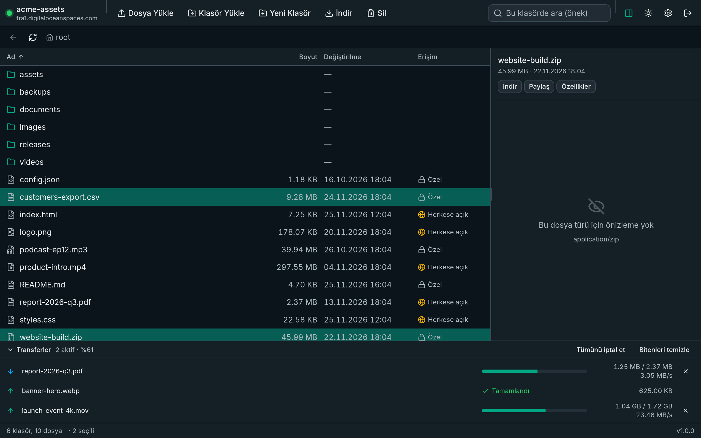

<div align="center">

# S3MANAGER

**DigitalOcean Spaces ve diğer S3 uyumlu depolama servisleri için çapraz platform masaüstü dosya yöneticisi**

[](LICENSE)
[](https://github.com/bahadirdogru/S3MANAGER/releases)
[](https://tauri.app/)
[](https://www.rust-lang.org/)
[](https://svelte.dev/)
[](https://github.com/bahadirdogru/S3MANAGER/releases)
[](https://s3manager.bahadirdogru.com/)

[Özellikler](#özellikler) · [Kurulum](#kurulum) · [Web sitesi](https://s3manager.bahadirdogru.com/) · [Kullanım](#kullanım) · [Geliştirme](#geliştirme) · [Dökümantasyon](#dökümantasyon)

</div>

---

> **Doc Map** — Proje dökümantasyon rehberi
>
> | Dosya | Ne için okunur |
> |-------|----------------|
> | [README.md](README.md) | Kurulum, kullanım, proje tanıtımı (İngilizce — GitHub/GitLab anasayfa) |
> | [readmetr.md](readmetr.md) | Kurulum, kullanım, proje tanıtımı (Türkçe) |
> | [docs/](docs/) | Tanıtım web sitesi ([s3manager.bahadirdogru.com](https://s3manager.bahadirdogru.com/)) |
> | [UI.md](UI.md) | Renk, tema token'ları, shadcn-svelte bileşen ve UX kuralları |
> | [ARCHITECTURE.md](ARCHITECTURE.md) | Mimari katmanlar, veri akışı, eşzamanlılık (insan okuması) |
> | [LLM.md](LLM.md) | Güncel kod yapısı, dosya haritası, geliştirme kısıtları (LLM) |
> | [process.md](process.md) | Kronolojik değişiklik kayıtları (changelog) |

## Hakkında

**S3MANAGER**, DigitalOcean Spaces'teki — veya AWS S3, MinIO, Cloudflare R2 gibi herhangi bir S3 uyumlu servisteki — dosyalarınızı yerel bir masaüstü uygulaması deneyimiyle yönetmenizi sağlar. Yükleme, indirme, paylaşım ve klasör yönetimi tek bir modern arayüzde birleşir.

v0.1.0'dan itibaren uygulama **Tauri 2** ile geliştirilir: **Rust** backend (`aws-sdk-s3`, `tokio`) ve **shadcn-svelte** bileşenleri kullanan **SvelteKit + TypeScript** frontend. Önceki PySide6 (Python) sürümü v0.0.9'a kadarki release'lerde bulunur.

Bu proje [Bahadır Doğru](https://bahadirdogru.com) tarafından **S3MANAGER** adıyla geliştirilmekte olup **GPL-3.0** lisansı ile açık kaynak olarak yayınlanmaktadır.

## Özellikler

<table>
<tr>
<td width="50%" valign="top">

### 📁 Dosya Gezgini
- Breadcrumb navigasyonu, geri geçmişi
- Sayfalı lazy loading (sonsuz kaydırma)
- Kolon sıralama, Ctrl/Shift çoklu seçim
- Kopyala / taşı / yeniden adlandır (F2, Ctrl+C/X)
- Sunucu tarafı önek araması
- Sağ panel önizleme (görsel, metin)
- Görünen satırlar için lazy ACL rozetleri

### ⬆️ Yükleme
- Dosya ve klasör yükleme
- Ana pencereye sürükle-bırak
- Private / Public ACL
- Otomatik Content-Type, Content-Disposition, Cache-Control
- Multipart (>16 MB), parça bazlı ilerleme
- Paralel yükleme (max 3); iptal multipart yüklemeyi de iptal eder

</td>
<td width="50%" valign="top">

### ⬇️ İndirme ve Paylaşım
- Tekli / çoklu dosya ve klasör indirme
- `.part` dosyasına yazılır, bitince yeniden adlandırılır
- 3 veya 7 günlük presigned URL, panoya kopyalanır
- public-read nesneler için açık URL

### 🎨 Modern Arayüz
- Tauri 2 + SvelteKit + shadcn-svelte
- WhatsApp esinli koyu/açık tema
- Hız ve ilerleme gösteren transfer paneli
- Bildirimler (toast), klavye kısayolları
- Ayrıntılar: [UI.md](UI.md)

</td>
</tr>
</table>

### Ekran görüntüsü



## Kurulum

### Binary (son kullanıcı)

[Releases](https://github.com/bahadirdogru/S3MANAGER/releases) sayfasından platformunuza uygun dosyayı indirin:

| Platform | Dosya |
|----------|-------|
| Windows | `S3MANAGER_<sürüm>_x64-setup.exe` (NSIS) veya `S3MANAGER_<sürüm>_x64_tr-TR.msi` |
| macOS (Apple Silicon) | `S3MANAGER_<sürüm>_aarch64.dmg` |
| macOS (Intel) | `S3MANAGER_<sürüm>_x64.dmg` |
| Linux x86_64 | `.AppImage`, `.deb` veya `.rpm` |

Minimum macOS **10.15 Catalina**'dır (Tauri/WKWebView). Linux'ta WebKitGTK 4.1 gerekir (güncel GNOME/KDE dağıtımlarında kuruludur).

> **Not:** Binary'ler kod imzalı değildir; Windows SmartScreen / macOS Gatekeeper uyarı verebilir.

### Kaynak koddan

Gereksinimler: [Rust](https://rustup.rs/) (stable), Node.js 22+, pnpm ve [Tauri sistem bağımlılıkları](https://tauri.app/start/prerequisites/) (Fedora: `webkit2gtk4.1-devel gtk3-devel libsoup3-devel openssl-devel`).

```bash
git clone https://github.com/bahadirdogru/S3MANAGER.git
cd S3MANAGER
pnpm install
pnpm tauri dev
```

İlk açılışta access key, secret, bölge/endpoint ve bucket girin. Bilgiler `~/.s3manager/config.ini` dosyasına kaydedilir — Python sürümünün kullandığı dosyanın aynısıdır, mevcut ayarlar çalışmaya devam eder.

## Kullanım

### Bağlantı

1. **DigitalOcean Spaces** (bölge seçin) veya **Diğer S3 uyumlu** (endpoint, bölge, MinIO vb. için isteğe bağlı path-style adresleme) seçin
2. Bucket, access key ve secret girin → **Bağlan** (bağlantı `HeadBucket` ile doğrulanır)
3. Kayıtlı bilgiler varsa uygulama açılışta otomatik bağlanır

### Dosya gezgini

- Klasöre çift tıklayın (veya Enter); breadcrumb, **Geri** (Backspace / Alt+←), **Yenile** (F5) ile gezinin
- Sıralamak için kolon başlıklarına tıklayın; Ctrl/Shift-tıklama ile çoklu seçim; sağ tık menüsü
- Arama kutusu mevcut klasörü sunucu tarafında ad önekine göre filtreler

### Yükleme

1. **Dosya Yükle** / **Klasör Yükle** veya dosyaları pencereye sürükleyin
2. Listeyi kontrol edin (üzerine yazılacak dosyalar işaretlenir), Özel/Herkese açık seçin → **Yüklemeyi başlat**
3. İlerleme, hız ve durum alttaki transfer panelinde görünür; her transfer iptal edilebilir

Content-Type ve Content-Disposition dosya uzantısına göre ayarlanır (ör. `.html` tarayıcıda açılır, `.zip` indirilir). Kurallar **Ayarlar → Metadata** sekmesinden düzenlenir (`config.ini` içinde `[upload_metadata]`).

### İndirme

Dosya/klasör seçin → **İndir** → hedef klasörü seçin. Klasörler alt klasörleriyle indirilir. Biten indirmelerde **Klasörde göster** düğmesi vardır.

### Paylaşım

Dosyaya sağ tıklayın → **Paylaş (3 Gün)** / **Paylaş (7 Gün)**. İmzalı link otomatik olarak panoya kopyalanır.

### Nesne özellikleri

Sağ tık → **Özellikler** (veya dosyada Enter / çift tık): Content-Type, Cache-Control, Content-Disposition, özel metadata (`x-amz-meta-*`) ve ACL düzenlenir. Herkese açık nesnelerde açık URL gösterilir.

### Ayarlar

| Sekme | İşlev |
|-------|-------|
| Bağlantı | Mevcut bucket/bölge/endpoint; bağlantıyı değiştir |
| Metadata | Content-Type / Disposition / Cache-Control kuralları |
| Görünüm | Koyu / açık tema |
| Günlük | `~/.s3manager/app.log` son satırları |
| Bakım | Yarım multipart yüklemeleri listele / iptal et |
| Hakkında | Sürüm, güncelleme kontrolü (GitHub Releases), bağlantılar |

### Klavye kısayolları

| Tuş | İşlem |
|-----|-------|
| F5 / Ctrl+R | Yenile |
| Del | Seçilenleri sil |
| F2 | Yeniden adlandır |
| Ctrl+A / Esc | Tümünü seç / seçimi bırak |
| Ctrl+C / Ctrl+X | Seçilenleri klasöre kopyala / taşı |
| Ctrl+U | Dosya yükle |
| Ctrl+Shift+N | Yeni klasör |
| Ctrl+F | Aramaya odaklan |
| Enter | Klasörü aç / dosya özellikleri |
| Backspace, Alt+← | Geri |

## Geliştirme

```bash
pnpm tauri dev      # Vite HMR ile uygulama
pnpm check          # svelte-check (TypeScript + Svelte)
pnpm test:rust      # Rust birim testleri
pnpm tauri build    # mevcut platform için release paketleri
```

### Canlı uç noktaya karşı testler

`pnpm test:live` ignore edilmiş entegrasyon testlerini çalıştırır (listeleme, sayfalama, kopyala/yeniden adlandır/sil, metadata, presign, multipart yükleme, klasör indirme, iptal). Her çalıştırma yeni bir `it-<uuid>/` öneki kullanır ve sonunda siler. Yerelde MinIO ile:

```bash
podman run -d --rm --name s3m-minio -p 9000:9000 \
  -e MINIO_ROOT_USER=minioadmin -e MINIO_ROOT_PASSWORD=minioadmin \
  cgr.dev/chainguard/minio:latest server /data
curl --aws-sigv4 "aws:amz:us-east-1:s3" --user minioadmin:minioadmin -X PUT http://localhost:9000/s3m-test

S3M_IT_ENDPOINT=http://localhost:9000 S3M_IT_KEY=minioadmin S3M_IT_SECRET=minioadmin \
S3M_IT_BUCKET=s3m-test S3M_IT_PATH_STYLE=1 pnpm test:live
```

MinIO canned ACL'leri yok sayar; Spaces veya AWS'de ACL doğrulaması için `S3M_IT_ACL=1` de ekleyin. CI aynı testleri build matrisinden önce MinIO'ya karşı çalıştırır.

### Release

Aynı sürümü `src-tauri/tauri.conf.json`, `src-tauri/Cargo.toml` ve `package.json` dosyalarına yazın, `release-notes/vX.Y.Z.md` ekleyin, commit edin:

```bash
git tag v0.1.0
git push origin main v0.1.0
```

`Release` workflow'u `tauri-action` ile Windows, macOS (arm64 + x86_64) ve Linux paketlerini üretir ve notlar dosyasını gövde olarak kullanan bir GitHub Release yayınlar.

## Günlük ve yapılandırma

- Günlük: `~/.s3manager/app.log` (2 MB'da döndürülür)
- Ayarlar: `~/.s3manager/config.ini` — örnek: [config.example.ini](config.example.ini)

## Geliştirme notu

Bu projenin kodlama sürecinde **LLM (Large Language Model)** araçları kullanılmıştır. Mimari kararlar, kod yapısı ve geliştirme kısıtları [LLM.md](LLM.md) dosyasında belgelenmiştir.

## Dökümantasyon

| Dosya | İçerik |
|-------|--------|
| [docs/](docs/) | Tanıtım sitesi — [s3manager.bahadirdogru.com](https://s3manager.bahadirdogru.com/) |
| [process.md](process.md) | Değişiklik geçmişi (changelog) |
| [ARCHITECTURE.md](ARCHITECTURE.md) | Mimari ve veri akışı |
| [UI.md](UI.md) | Tasarım sistemi |
| [LLM.md](LLM.md) | LLM geliştirme rehberi |

---

<div align="center">

## Yazar ve Lisans

**S3MANAGER** — Copyright © 2026 [Bahadır Doğru](https://bahadirdogru.com)

Bu proje [GNU General Public License v3.0](LICENSE) lisansı ile açık kaynak olarak yayınlanmaktadır.

</div>
